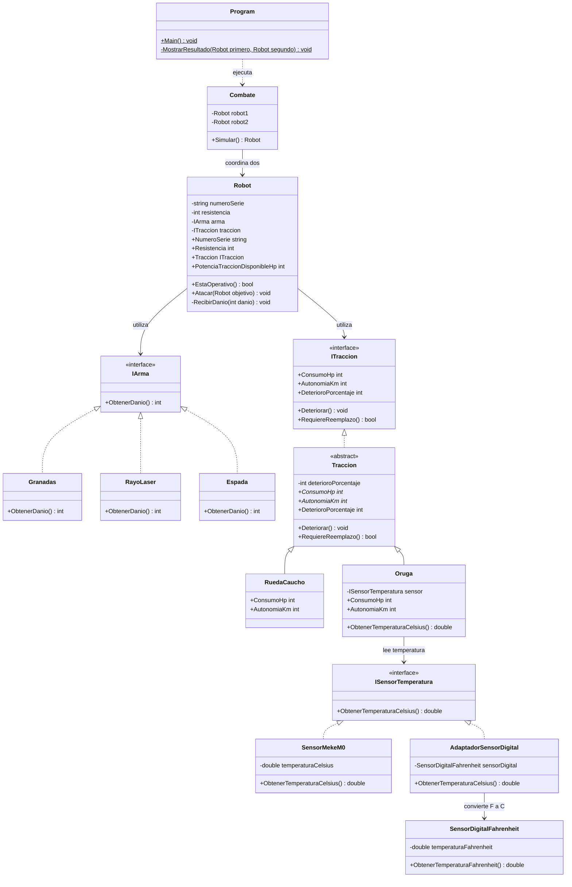

# Robots — UML final (código implementado)

Constructores omitidos por legibilidad. El resultado de `Combate.Simular()` es `Robot?` en C# (puede no haber ganador si ambos quedan inoperativos en el mismo ataque).
